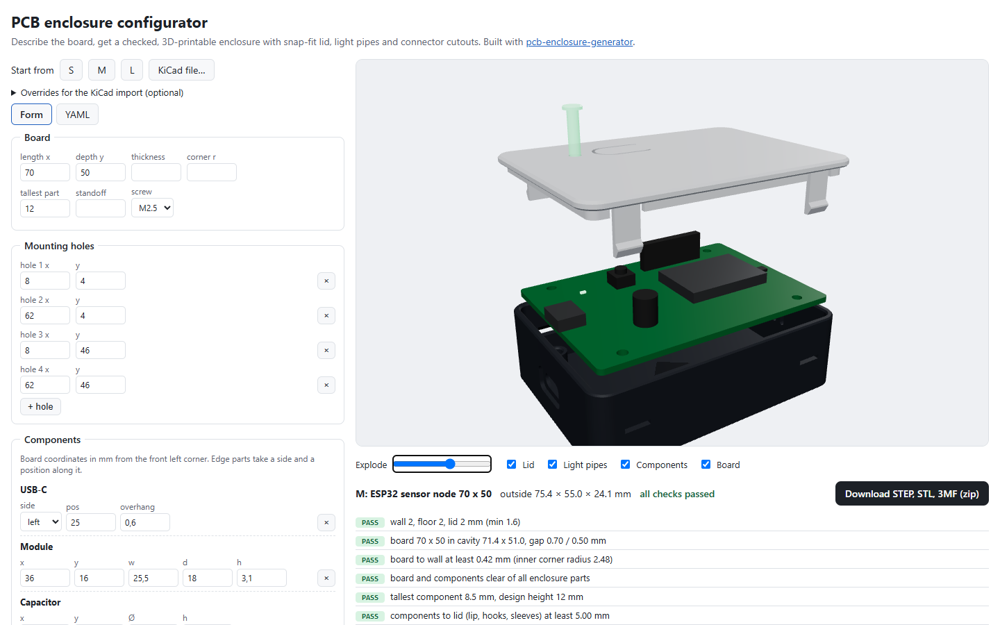

# PCB enclosure configurator

[](https://github.com/sc000byd00/enclosure-configurator/actions/workflows/ci.yml)

A web front end for [pcb-enclosure-generator](https://github.com/sc000byd00/pcb-enclosure-generator): describe a circuit board in a form or upload a KiCad file, look at the enclosure in 3D, read the design checks and download STEP, STL and 3MF.



## What it does

- **Form or YAML.** Board size, mounting holes, components (USB-C, DC jack, terminal, vents, LEDs, button, modules, headers, capacitors), snap hooks, button style, wall mount. The YAML tab shows the same board in the generator's file format, to copy or edit.
- **KiCad upload.** A `.kicad_pcb` file is read on the server: outline, holes, components and which edge each connector sits on. Optional overrides (button style, vents, corrections) go in a text box. Warnings, for example for parts on the bottom side, are listed.
- **3D preview** of base, lid, light pipes, board and components, with an exploded view and parts that can be hidden.
- **Design checks** from the generator: wall thickness, clearances, collisions, plug fit, snap-hook strain and forces. A failing design is still shown, with the failed checks marked.
- **Download** of all parts in print orientation as STEP, STL and 3MF, plus the check report and the board file, in one zip.

## Architecture

```
web/  Next.js (TypeScript), react-three-fiber viewer        -> static site, GitHub Pages
api/  FastAPI around the generator (build123d, Python)        -> container, Hugging Face Space
```

The browser sends the board as JSON to `POST /api/build`. The API validates it, builds the enclosure in a separate process with a time limit, and returns the checks and a list of part meshes. Results are cached on disk by a hash of the input, so the same board is built once.

| Endpoint | |
| --- | --- |
| `POST /api/build` | board (generator format) → checks, outside size, part meshes, zip link |
| `GET /api/files/{id}/{part}.stl` | mesh in assembly position, for the viewer |
| `GET /api/files/{id}/enclosure.zip` | STEP, STL, 3MF, report, board file |
| `POST /api/kicad` | `.kicad_pcb` upload (+ overrides) → board |
| `GET /api/presets`, `GET /api/health` | |

Interactive API docs at `/api/docs`.

### Limits

To keep a public instance cheap and responsive:

- builds run in a child process and are stopped after 90 s, at most two at a time
- 30 builds and 30 uploads per client and 10 minutes
- request body 64 kB, KiCad file 2 MB
- board up to 300 mm, 60 components, 16 holes, 12 snap hooks, 40 vent slots
- file names and ids in download URLs are checked against a strict pattern

Settings by environment variable: `ALLOWED_ORIGINS` (CORS, comma-separated), `CACHE_DIR`, `BUILD_TIMEOUT`, `RATE_LIMIT`.

## Run locally

```bash
# API, http://localhost:8000
cd api
python -m venv .venv && .venv/bin/pip install -r requirements-dev.txt   # Windows: .venv\Scripts\pip
.venv/bin/uvicorn app.main:app --port 8000

# web, http://localhost:3000
cd web
npm ci
npm run dev
```

The web app reads the API address from `NEXT_PUBLIC_API_URL` (default `http://localhost:8000`, see `web/.env.example`).

## Tests

```bash
cd api && pytest                 # build, cache, files, limits, KiCad upload, rate limit
cd web && npm test               # board model, YAML, quick checks, exploded view
cd web && npm run test:e2e       # form -> preview -> download, YAML tab, error display
```

The end-to-end tests run against the Next.js app with the API mocked, so they need no Python. Locally, `PW_CHANNEL=chrome npm run test:e2e` uses the installed Chrome. CI also builds the API container and runs a real build in it.

## Deploy

Live demo: **https://sc000byd00.github.io/enclosure-configurator/** (the first build after a pause can take a minute while the free API container wakes up).

- **Web:** the app is fully client-side and exported as static files (`output: "export"`). The `Pages` workflow builds it with `BASE_PATH=/enclosure-configurator` and the API address, and publishes `web/out` to GitHub Pages.
- **API:** `api/Dockerfile` is a complete image (port 7860). The demo runs as a Hugging Face Docker Space whose Dockerfile clones this repository at a fixed commit and installs `api/`; `ALLOWED_ORIGINS` there allows the Pages address.

## License

MIT, see [LICENSE](LICENSE).
